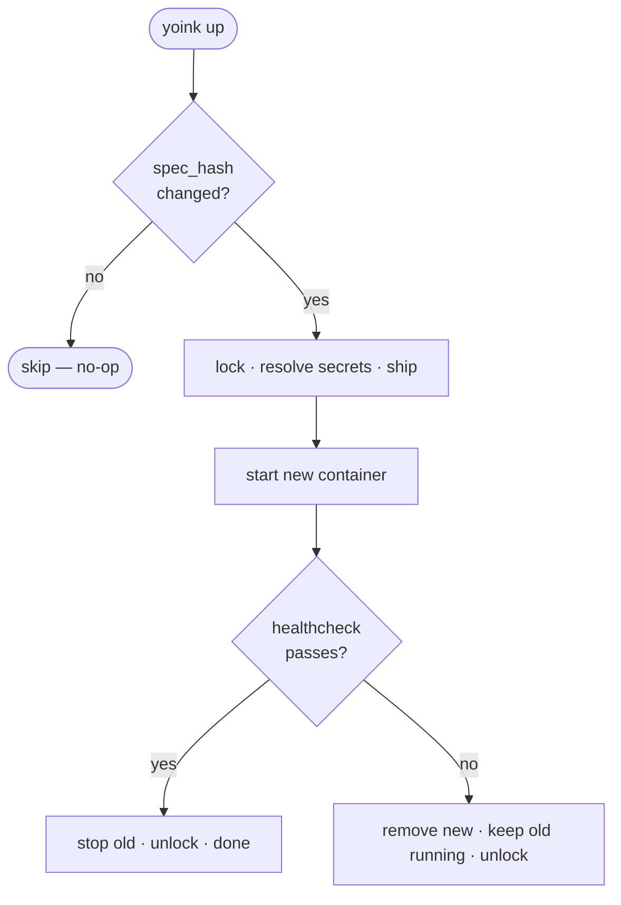

`docker compose up`, `ssh && docker run`, and hand-written bash scripts have the same four failure modes. yoink has one mechanism for each.

| Failure mode of the scripts | Mechanism in yoink |
|---|---|
| They create containers again that did not change, or they skip containers that changed. | A content hash on every container detects drift. |
| They swap atomically only if you add the healthcheck flags. | A healthcheck gates each swap, so a broken build does not replace a container that works. |
| Two concurrent runs corrupt the host state, and no error shows. | A deploy lock stops concurrent runs. |
| They keep no audit trail. | An audit trail with one-key rollback records each run. |



## Drift detection

Every container that yoink manages has a `yoink.spec_hash` label. The label holds the first 16 hex characters of the `sha256` of a deterministic encoding of the **effective spec**. Two containers with the same `spec_hash` have the same effective spec.

The effective spec is everything that changes how the container runs:

- The resolved image and tag.
- The resolved env.
- The networks, the mounts, the run options, and the ports.
- The entrypoint and the command.
- The content hash of every `files:` mount. Thus a change to a config file redeploys the service.

[Deploy mechanics](/docs/reference/deploy-mechanics#spec_hash-inputs) lists every input.

yoink does not hash values that change on each deploy or that differ between hosts:

- The container name, because it contains the short hash.
- The audit labels, which record who deployed and when.
- The host address. The same spec runs on every applicable host.

Four behaviors depend on this hash:

- `yoink up` skips each service whose desired hash is the same as the running hash. It does no pull and no swap.
- `yoink up --dry-run` compares the desired hash and reports Create, Update, or NoOp for each service.
- The drift column of the TUI dashboard reads the labels of the running containers and shows ✓ or ⚠.
- Two services with the same spec on different hosts or replicas have the same hash. Drift applies to a spec, not to a container.

If `yoink up` redeploys every service and you did not expect it, an input of the hash changed. The usual causes:

- A default changed between yoink versions. Every `v0.x.0` change to the security defaults did this one time.
- A secret value changed, which changes the resolved env.
- The content of a `files:` mount changed.

## Deploy lock

`yoink up` takes an advisory lock on each host. The lock stops two operators, or an operator and a CI runner, from changing the same docker daemon during a deploy.

`yoink prune` takes the same lock on each host before it removes containers. `yoink prune --dry-run` does not take the lock. Thus a prune cannot remove the stopped old container of a stop-first deploy. The deploy must start that container again if the new container does not become healthy.

The lock is a sentinel container with the name `yoink-deploy-lock`, not a file lock. Thus the lock releases itself after a crash on the operator side. The sentinel runs a small shell loop that watches the file `/tmp/heartbeat`. The loop exits when the file is older than approximately 30 seconds. While yoink holds the lock, it runs `docker exec` in the sentinel every 5 seconds to touch `/tmp/heartbeat`.

| Situation | Result |
|---|---|
| Two operators start at the same time | The first `create_container` call wins. The `acquire` of the second operator stops with an error. |
| The sentinel runs when a second `up` starts | The second `up` stops with the error "another deploy in progress". The second operator waits and runs `up` again. |
| The operator process crashes, gets a SIGKILL, or loses the network | The heartbeat task stops with the process. The sentinel exits in 30 seconds. The next deploy removes the stopped sentinel and starts a new one. |
| A TUI session leaves a sentinel | The sentinel exits in 30 seconds after the session closes. `yoink lock release --yes` removes it immediately. |
| `up` ends, with success or with an error | yoink stops the heartbeat and force-removes the sentinel. The next deploy acquires the lock immediately. |

[Deploy mechanics](/docs/reference/deploy-mechanics#deploy-lock) lists the lock parameters and the log line that shows a lost lock.

## Dependency-ordered deploys

Each service declares the services that it needs:

```yaml
services:
  - name: api
    depends_on: [redis]
  - name: web
    depends_on: [api]
  - name: caddy
    depends_on: [api, web]
```

`yoink up` sorts the services topologically and runs them in **waves**. A wave contains the services whose dependencies are all complete. The services in one wave run **concurrently**. The waves run **sequentially**.

The config above gives four waves:

- Wave 0: `redis` (no dependencies)
- Wave 1: `api` (`redis` is complete)
- Wave 2: `web` (`api` is complete)
- Wave 3: `caddy` (`api` and `web` are complete)

The order matters for hooks. The `pre_deploy` hooks of a service run in the wave of that service, immediately before its new containers start. Thus a database migration completes before the new `api` container starts, and after `redis` is complete.

`yoink validate` and every deploy command reject a cycle in `depends_on:` when they load the config. This occurs before yoink connects to a host.

## Secrets resolution

The key `secrets.provider:` selects one of two providers:

- **`age`** (the default, included in yoink): yoink decrypts a sealed `secrets.age` file at deploy time with one X25519 identity. [Deploy mechanics](/docs/reference/deploy-mechanics#age-identity-lookup-order) gives the lookup order for the identity.
- **`command`**: yoink runs the command from the config one time for each `yoink up` and parses stdout as a secrets bundle. [Deploy mechanics](/docs/reference/deploy-mechanics#command-provider-output) gives the formats.

The two providers give the same result: a bundle of keys and values. yoink injects the values that a service lists in `secrets:` (or `env_from_secrets:`) as env vars on the container. Those values are inputs of `yoink.spec_hash`, so a new secret value starts a redeploy.

[Secrets](/docs/explanation/secrets) gives the full model and the cases where an external secret manager fits better.

## Prune semantics

`yoink prune` removes only containers that yoink owns. The label `yoink.managed=true` shows ownership, so `prune` does not touch containers that yoink did not create. It removes two kinds of container:

- A container of a service that the current config does not declare, after a service rename or a service removal.
- A stopped container of a service that is in the config: a stale generation from a previous deploy. This includes the previous generation that `yoink rollback` reads.

`prune` keeps three things:

- The running containers of every service in the current config.
- The sentinel container of a deploy that is in progress, so the lock stays.
- Volumes and networks, because `docker volume prune` and `docker network prune` are the tools for those.

`yoink prune --dry-run` prints the containers that `prune` will remove, and it removes nothing. [Deploy mechanics](/docs/reference/deploy-mechanics#yoink-prune-rules) gives the exact rules.

## Runtime container shape

When yoink creates a container, it builds the docker host config from `service.run.options` and a small number of fixed parts:

- It adds safe mount options to `tmpfs` mounts.
- It makes bind mounts read-only unless you set a mode.
- It runs tini as PID 1 by default.
- It uses the first network as the network mode and attaches the other networks before the start.

[Deploy mechanics](/docs/reference/deploy-mechanics#container-host-config) lists each part. [Security defaults](/docs/reference/security-defaults) has the full table of security defaults, and [Security](/docs/explanation/security) gives the reasons.

## Healthcheck-gated rolling swap

For each service, on each of its hosts, yoink does this sequence:

1. yoink resolves the tag, builds the spec, and computes the `spec_hash`.
2. If a container with the same name and `spec_hash` runs, yoink skips that replica (no-op).
3. yoink pulls the image unless the image is on the host. An earlier phase ships each built image from your laptop, and `--no-registry` ships every image that way.
4. yoink creates the new container for each replica and does not start it. The name is `<service>-<short_hash>`, or `<service>-<short_hash>-<idx>` for replicas.
5. yoink runs the `pre_deploy` hooks of the service.
6. yoink starts the new replicas one at a time and probes each one: an HTTP GET on `healthcheck_path`, or a TCP connect on `port` if no path is set. It tries again with a backoff until the probe passes or `healthcheck_timeout` elapses.
7. If every probe passes, yoink stops the containers of the previous generation. Docker waits `drain_timeout` for a graceful shutdown, then it kills the container. The stopped containers stay on the host, and `yoink rollback` reads the previous tag from them.
8. If a probe fails, yoink removes every container that the failed attempt created for the service on that host. This includes the replicas that already passed. The old containers keep running. yoink prints the last 30 log lines of the failed container and writes them to the audit log as `DeployFailed`.

After a healthcheck failure, the log lines show the cause. Then you correct the config or roll back.

The old replicas run until every new replica passes, so the capacity does not decrease during the swap. A service with `publish:` is the exception. A host port has one owner, so yoink stops the old container before it starts the new one.

The swaps of different services in the same wave run concurrently.

## See also

- [Deploy mechanics](/docs/reference/deploy-mechanics): the hash inputs, lock parameters, prune rules, and host config in list form.
- [Deploy modes](/docs/explanation/deploy-modes): how the build origin and the distribution method work together.
- [Networking](/docs/explanation/networking): the distribution of services across hosts and the no-publish default.
- [Configuration reference](/docs/reference/config): every field that is an input of `spec_hash`.
- [Pre-merge dry-run on every PR](/docs/how-to/pr-comment-dry-run): a task that uses drift detection in PR comments.
