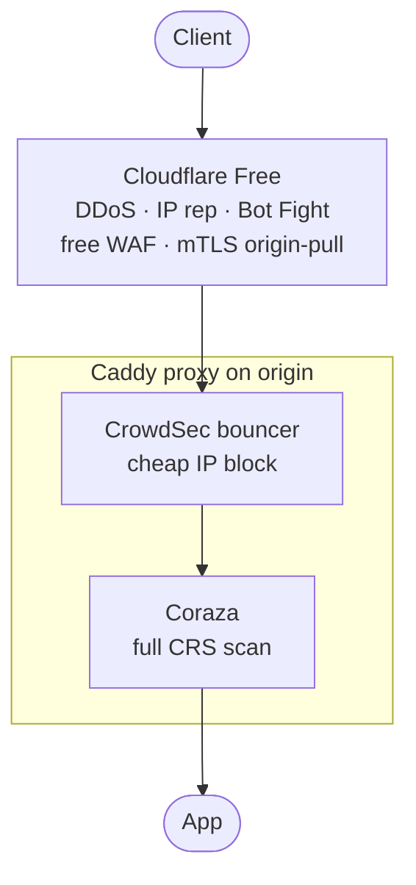

This stack gives defense in depth for public-facing services with no license fee. Each layer does a job that the other layers cannot do:

- Cloudflare Free is at the edge. An Origin Certificate with mTLS locks the origin to Cloudflare.
- [CrowdSec](https://www.crowdsec.net/) bans clients at the proxy from their behavior in the logs.
- [Coraza](https://www.coraza.io/) inspects payloads against signatures.

This stack is not a yoink default. It requires plugins, secrets, a CrowdSec sidecar, and continuous security operations. yoink reduces the *deploy* to one config file. The security engineering stays with you.

## Architecture

## What each layer brings

**Cloudflare Free + Origin Certs.** Cloudflare absorbs DDoS traffic at the edge and filters by IP reputation across millions of zones. It also supplies Bot Fight Mode and the Cloudflare Free Managed Ruleset. That ruleset is a curated subset for high-profile and emergency CVEs such as Log4j and Shellshock. A Cloudflare Origin Certificate together with `client_auth: {mode: require_and_verify}` locks the origin. The origin then terminates TLS only for connections that present a Cloudflare-signed client certificate.

Cloudflare Free has limits. Request-body inspection stops at 1 MB. Broader managed rules and OWASP CRS at the edge require the Pro plan or higher.

**CrowdSec + caddy-crowdsec-bouncer.** This layer detects behavior from logs. The CrowdSec agent reads your Caddy and app logs for failed logins, 404 scans, brute force, and path traversal probes. It emits decisions that are specific to *your* traffic. For example, Cloudflare cannot see app-level brute-force attempts on your `/login`. The bouncer enforces the decisions at the proxy, in microseconds for each request. CrowdSec also supplies a crowdsourced blocklist from its global community.

**Coraza.** Coraza is a drop-in replacement for ModSecurity with the full OWASP Core Rule Set (PL1 to PL4). It scans request bodies, headers, and URLs against thousands of CVE and exploit patterns. Coraza complements CrowdSec: CrowdSec catches *who*, and Coraza catches *what*.

## Why the handler order matters

The order in `global_handlers:` is the order of the request pipeline. CrowdSec comes first because its IP lookup takes microseconds. Coraza comes second because request parsing and CRS evaluation are expensive. In the reverse order, Coraza uses CPU on traffic that CrowdSec then rejects.

`proxy.global_handlers:` applies the two plugins to every routed service. A new app in `services:` gets the protection without a copy of the plugin config. For per-service changes, such as a different rate-limit zone for each app, `caddy_extra_json:` still works together with the global handlers.

## Why the real client IP matters

The `proxy.config_extra:` block tells Caddy to trust the edge of Cloudflare as a proxy and to read the real IP from `CF-Connecting-IP`. Without that block, the bouncer and Coraza see the edge IPs of Cloudflare. Then the first attack from a real client bans all of the edge, and the site goes offline globally. This is the most frequent failure of this stack.

The `caddy-cloudflare-ip` plugin gets the published IP ranges of Cloudflare and refreshes them. `trusted_proxies: {source: cloudflare}` in `config_extra` uses that module. Without the plugin, the ranges are hardcoded, and you update them by hand when Cloudflare changes them.

## Why a leaked origin IP matters

A leaked origin IP lets attackers skip the edge, and that defeats Cloudflare fully. DNS history, Certificate Transparency logs, an unproxied subdomain, or the A record of your mail server can each expose the origin. Two barriers stop a leaked IP:

- A host firewall that accepts only [Cloudflare's published IP ranges](https://www.cloudflare.com/ips/) on `:80` and `:443`. It stops the TLS connection.
- The mTLS layer (`client_auth: {mode: require_and_verify}`).

## How the containers connect

The proxy reaches the app and CrowdSec by container name over `yoink-ingress`. yoink creates this network and connects the proxy and every routed service to it. The `crowdsec` service has no `domain:`, so it is not routed and not public. It still joins `yoink-ingress`, which is the yoink default for services without an explicit `networks:` list. Thus the bouncer reaches it as `crowdsec:8080`. Only the proxy talks to CrowdSec.

## What yoink leaves to the plugins

yoink does the deploy. The docs of each project cover the operations that are specific to a plugin: CRS paranoia levels, false-positive tuning, CrowdSec scenario authoring, and audit-log triage.

## See also

- [Defense-in-depth web serving](/docs/how-to/defense-in-depth): the config and the steps to deploy this stack.
- [Cloudflare Origin Certificates](/docs/how-to/cloudflare-origin-certs): the dashboard steps for the origin certificate and origin-pull mTLS.
- [Reverse proxy](/docs/explanation/proxy): how the proxy-wide config and the middleware chain work.
- [Security](/docs/explanation/security): the container hardening that yoink applies by default.
- [CrowdSec docs](https://docs.crowdsec.net/): agent setup, scenarios, and the hub.
- [Coraza docs](https://coraza.io/docs/): directives, paranoia levels, and audit logs.
- [OWASP Core Rule Set](https://coreruleset.org/docs/): what the CRS rules do.
