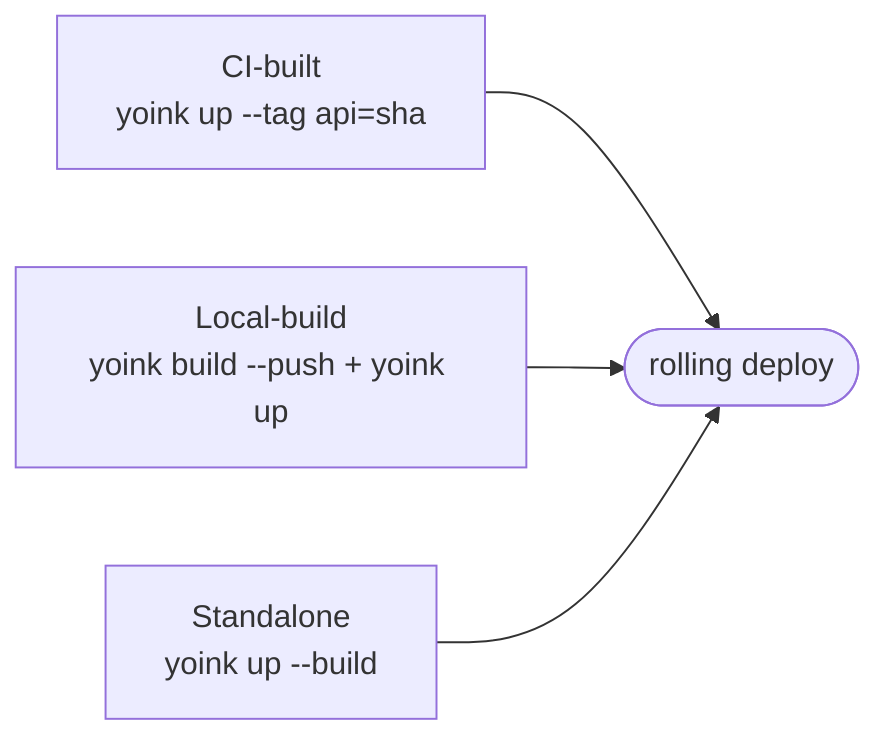

yoink treats **where the image is built** and **how the image gets to the host** as independent choices. Each service and each environment can use a different combination.

**Build origin:**
- **In CI.** A CI system such as GitHub Actions or GitLab builds and tags the image on each merge. The service has no `build:` block. This fits production with an existing CI/CD pipeline.
- **On your machine.** The service has a `build:` block, and `yoink build` or `yoink up --build` runs `docker build` locally. This fits indie teams, one-person teams, and fast local iteration.

**Distribution:**
- **Through a container registry.** Each host runs `docker pull` against a registry (real, self-hosted, or pull-through). Because of registry-protocol dedup, only changed layers go across the wire. This fits multi-host production, audit, and tag-based rollback.
- **Direct to host, no registry.** yoink ships the image from your docker daemon to each host over SSH. By default, this path uses an ephemeral [unregistry](https://github.com/psviderski/unregistry) sidecar, so only the changed layers go across the wire on a redeploy. This fits fast iteration, hobby, indie, and prototype hosts, and air-gapped environments.

The `build:` block selects the distribution, and no flag is necessary. Plain `yoink up` ships a service that has a `build:` block over SSH. Each host pulls a service that has no `build:` block from its registry.

| Build origin → / Distribution ↓ | In CI | On your machine |
|---|---|---|
| **Through a registry** | CI pushes, hosts pull. The default for production. | `yoink build --push` puts the image in the registry. If the config that you deploy has no `build:` block for the service, the hosts pull the image. |
| **Direct to host (no registry)** | Less common, but valid. CI builds, then runs `yoink up --transport=unregistry --tag api=<sha>` on a config whose service has a `build:` block. `--no-registry` forces local shipping for non-build services also. | `yoink up --build`, one command. The standalone loop. |

The four cells share one deploy engine. Drift detection, the healthcheck-gated rolling swap, and dependency-ordered waves work the same for each way that an image arrives.

A mixed config needs no more config. In a single `yoink up`, yoink first ships the services that have a `build:` block. Then the hosts pull the other services from their registries.

## CI-built: the default

CI pushes the image to a registry on each merge, and `yoink up` pulls the image and rolls it. The image reference is fully qualified (`image: ghcr.io/you/api`). `--tag api=<sha>` usually overrides the tag at deploy time.

## Local-build (push-then-deploy)

The service has a `build:` block, and its `image:` is a real registry path. `yoink build --push` runs `docker build` against your local docker daemon and tags the result as `<image>:<tag>`. This tag is equal to the registry path because of the value of `image:`. Then the command runs `docker push`.

`yoink up` then does a rolling swap. From a config that has the `build:` block, yoink ships the image from your local daemon over SSH, and the hosts do not pull it. From a config without the `build:` block, each host pulls the pushed image.

The two steps are deliberate. `yoink build && yoink up` keeps the two phases apart, and that gives you two possibilities:

- You can build without a push, for your own CI.
- You can run the steps on different machines: build on a fast laptop, deploy from a thin runner. The config on the runner must have no `build:` block for the service, because the runner has no local copy of the image.

For the config and the commands, see [Build locally and deploy through a registry](/docs/how-to/local-build-push).

## Standalone (no registry)

A `yoink.yaml` next to your `Dockerfile` and one `yoink up --build` are sufficient. One command builds, ships, and runs the service. There is no CI to configure, no registry account, and no auth. A tarball fallback is available for air-gapped hosts that cannot use the unregistry transport.

For the commands and the transport details, see [Standalone (no-registry) deploys](/docs/how-to/standalone-mode).

A registry that you operate yourself is the middle ground, and you do not pay for it. See [Self-hosted registry on a yoink host](/docs/how-to/self-hosted-registry).

## See also

- [Build locally and deploy through a registry](/docs/how-to/local-build-push): the config and commands for the local-build mode.
- [Standalone (no-registry) deploys](/docs/how-to/standalone-mode): the procedure for the standalone mode.
- [Self-hosted registry on a yoink host](/docs/how-to/self-hosted-registry): a registry that you do not pay for.
- [Edit-save-deploy with `--watch`](/docs/how-to/watch-mode): use it with standalone mode for the shortest iteration loop.
- [Configuration: `build:` block](/docs/reference/config): the full schema for the build origin.
