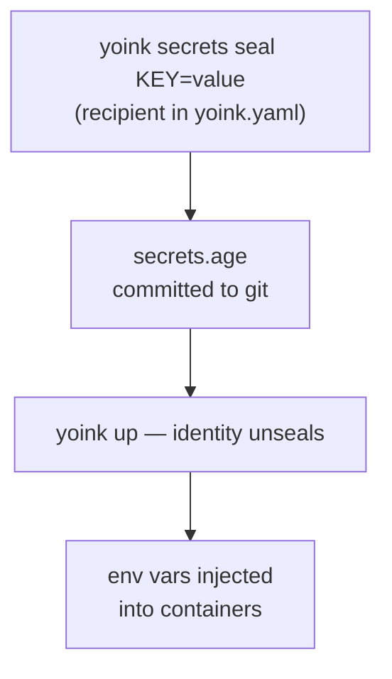

yoink has two secrets providers and one model. A key→value bundle resolves at deploy time, and yoink injects it as env vars into the containers that reference it. The default (`provider: age`) seals the bundle into a file that you commit to git. The escape hatch (`provider: command`) runs the CLI of the secret manager that you already have.

With the two providers, the resolved values are inputs of [`yoink.spec_hash`](/docs/explanation/architecture#drift-detection). Thus a secret rotation starts a redeploy, as a config change does.



The commands for the keypair, the sealed values, and rotation are in the [Sealed secrets workflow](/docs/how-to/sealed-secrets-workflow).

## Sealed secrets (age)

age uses an **asymmetric keypair**, the same shape that SSH and GPG use. `yoink secrets key generate` prints the two halves. They are not interchangeable, and the place of each half is the whole model:

| | What it looks like | Where it lives | What it can do |
|---|---|---|---|
| **Recipient** (public half) | `age1w8jcq22re378p38…` | `secrets.recipients:` in `yoink.yaml`, committed to git | **Seal** new values into `secrets.age`. Cannot decrypt. |
| **Identity** (private half) | `AGE-SECRET-KEY-1QQPQZ…` | Your secret manager (GitHub Actions secret, 1Password, AWS SM, and others). It arrives at deploy time as `YOINK_AGE_KEY`. | **Unseal** existing values. Also seals. Never goes into git. |

The asymmetry makes the file safe to commit. The file is sealed against the public recipient, so each reader of the repo sees only ciphertext. Decryption needs the private identity, which never goes into git.

This model has four consequences:

- **A new file needs only the recipient, but a change to an existing file needs the identity.** When `secrets.age` does not exist, `yoink secrets edit` and `seal` work without `YOINK_AGE_KEY`. When the file exists, the two commands decrypt it first, merge the new values, and seal again.
- **Multiple recipients mean multiple readers.** `secrets.recipients:` is a list. A seal against `[recipient_a, recipient_b]` makes one file that either identity can decrypt. Rotation uses this (a transition state with the old and the new recipient). Multi-operator teams use it too (the age key of each engineer is a recipient).
- **The recipient comes from the identity, but the identity does not come from the recipient.** If you lose the recipient string and still have the identity, `yoink secrets key public` derives it again. If you lose the identity, every value that is sealed against it is gone. Thus backups must cover the identity.
- **`yoink secrets key public` shows which key is active.** It derives the recipient from the identity that yoink uses at that moment. It answers the question "is the key in my shell the key that `yoink.yaml` expects?".

The [`examples/sealed-secrets/`](https://github.com/oddur/yoink/tree/main/examples/sealed-secrets) walkthrough runs every step against the docker daemon of your laptop. It needs no ssh and no registry.

## Threat model

Sealed secrets cover these risks:

- **Exposure of the repo or the git history.** Anyone with read access to the repo (collaborators, mirrors, leaked clone tarballs, future Dependabot bots) sees only ciphertext. Without a matching age identity they cannot recover values.
- **Backup blast radius.** If the age identity is not in the same place, these leak no secrets: repo backups, the CI artifact cache, and a lost laptop with a checkout.

Sealed secrets do **not** cover these risks:

- **A compromised `YOINK_AGE_KEY`.** The key holder is the trust anchor. Three examples are a breached CI runner, a stolen unlocked laptop, and a `YOINK_AGE_KEY` in a workflow log that someone pasted into Slack. Each one exposes every value sealed against that recipient. [Compromised key](/docs/how-to/sealed-secrets-workflow#compromised-key-emergency-rotation) covers the cleanup.
- **Runtime exposure on the host.** After decryption, values are in container env vars. Anyone with `docker exec` or `docker inspect` against the running daemon can read them. yoink assumes that the docker socket is already privileged. The socket is not a sandbox boundary.
- **An audit trail of who read which value.** age has none. Every operator with the identity decrypts silently. `provider: command` against a managed store (Vault, Doppler, AWS SM) can answer "who looked at this and when".
- **Per-key git diffs.** The whole `secrets.age` file changes on every edit, so PR review cannot show which key moved. For that case, `provider: command` with [sops](#sops) keeps key names in plaintext and encrypts only the values.

## Identity resolution

When yoink must decrypt, it tries a fixed list of sources and stops at the first match. Two env vars come first, then the keys directory `~/.config/yoink/keys/`, then a legacy single-key path. The exact order is in the [reference](/docs/reference/secrets#identity-resolution).

The scan of the keys directory lets multiple projects work with no env vars for each project. `yoink secrets key generate` writes there by default. yoink then picks the key whose recipient is in the loaded `yoink.yaml`.

Inside any project, `yoink secrets key public` prints the recipient of the identity that resolved there.

## When age is not enough

`provider: command` is the better fit when you need one of these:

- **Per-key git diffs** in place of changes to an opaque blob: [sops](#sops).
- **Cloud KMS as the root of trust** (AWS, GCP, Azure, Vault transit), so that no private key is on operator laptops: sops also covers this.
- **Centralized rotation across many repos**: Doppler, 1Password, the Infisical CLI.
- **An audit trail of who read which value and when**: Doppler, Vault, AWS Secrets Manager.
- **Fine-grained ACLs** (for each team, for each environment): Vault, AWS SM, sops with KMS.
- **Secrets that must NOT be in a git history** (regulatory): any managed service.

## External secrets via CLI (`provider: command`)

`provider: command` is the bring-your-own-tool path. yoink runs the command from the config and reads the bundle from stdout. Then it feeds the bundle to the same machinery that `provider: age` uses. yoink has no first-party integrations to maintain and no SDK to vendor.

```yaml
secrets:
  provider: command
  command: ["doppler", "secrets", "download", "--no-file", "--format", "env"]
```

yoink starts the binary directly, with no shell, and passes only an allowlist of env vars to it. The allowlist holds a base set and the auth tokens of the common tools. `YOINK_AGE_KEY` is not on it. All allowlisted tokens reach the command, whichever tool it runs. If that is not acceptable, an env-scrubbed wrapper is the answer.

yoink treats a malformed bundle as a hard error, because a loud failure is better than a silent loss of an export with a typo. For the same reason, a JSON number or boolean is an error and not a silent conversion to a string.

[Read secrets from an external secret manager](/docs/how-to/external-secrets) has the config for each secret manager. The [reference](/docs/reference/secrets#provider-command) has the rules for the command and the bundle formats.

### sops

[sops](https://github.com/getsops/sops) keeps the "sealed file in the repo" model of the `provider: age` default and adds these capabilities:

- **Per-key git diffs.** sops encrypts only values, and key names stay in plaintext. PR review of a secret change shows which key moved.
- **Multi-cloud KMS as the root of trust.** sops encrypts to AWS KMS, GCP KMS, Azure Key Vault, or Vault transit. Decryption uses an IAM role at deploy time, with no private key on operator laptops.
- **Per-value MAC** for tamper detection at the field level.
- **Granular rotation.** `sops updatekeys` changes the data key and does not encrypt every value again.
- **Format flexibility.** sops encrypts YAML, JSON, INI, dotenv, and binary, and supports nested structures.

The cost of sops is one more binary to install and one more `.sops.yaml` config to maintain. With cloud KMS, it is also a network dependency at deploy time.

sops is the correct choice when one of the capabilities above pays for that overhead. Examples are readable git diffs for many secret reviewers, or KMS as the root of trust for compliance reasons. The `provider: age` default fits a small team with one source-of-truth repo and one private key for each environment.

<Callout type="warn">

**sops with cloud KMS makes the deploy depend on the network and on IAM.** A `sops -d` against AWS, GCP, or Azure KMS calls the cloud control plane on every run. The runner can fail to reach the KMS endpoint: a DNS fault, a VPC route flap, an expired IAM role, or a KMS key that is disabled during rotation. Then the deploy fails at the secrets step, and yoink cannot recover.

A deploy that depends on KMS needs three things:

- An alarm on KMS request failures.
- A narrow but durable IAM role on the runner, not one tied to a session that expires during deploys.
- A break-glass plan for a KMS outage: a sealed `secrets.age` mirror, or a static export that you rotate quarterly.

The `provider: age` default has none of these network failure modes. The sealed file is local, and `YOINK_AGE_KEY` is only a string.

</Callout>

## See also

- [Sealed secrets workflow](/docs/how-to/sealed-secrets-workflow): the tasks for `provider: age`: generate an identity, seal values, use them, multiple environments, backup, rotation.
- [Read secrets from an external secret manager](/docs/how-to/external-secrets): `provider: command` config for sops, Doppler, Infisical, Vault, AWS Secrets Manager, 1Password, and Bitwarden.
- [AGE secrets in GitHub Actions](/docs/how-to/age-in-github-actions): the short recipe for the CI side.
- [Secrets resolution and bundle formats](/docs/reference/secrets): the identity resolution order, the command rules, and the dotenv and JSON formats.
- [Configuration reference: secrets](/docs/reference/config): the full schema for the two providers.
