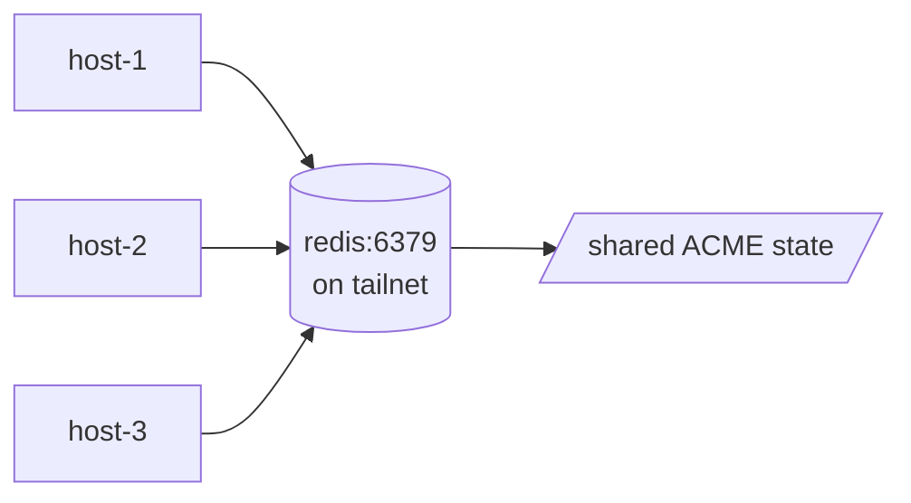

When many hosts serve the same domain, the Caddy on each host requests its own cert from Let's Encrypt. **You then hit the rate limits in less than a week.** To prevent this, all proxies share the ACME state through one Redis instance on a private network.

If you use the Cloudflare edge, [Origin Certificates](/docs/how-to/cloudflare-origin-certs) are simpler, because they use no ACME.

## Architecture



- yoink deploys **one Redis** instance on one host.
- All proxies use the [`caddy-storage-redis`](https://github.com/pberkel/caddy-storage-redis) plugin, which points the storage of Caddy at Redis.
- **Tailscale** (or any private network) keeps Redis off the public internet.

The one Redis instance is a single point of failure for cert issuance and renewal only. Caddy does not use it for request-path traffic.

## Setup

### Connect every host to the tailnet [step]

The proxies on `prod-2` and `prod-3` must reach `redis:6379` on the tailnet IP of `prod-1`. Put every host on the tailnet. The [networking page](/docs/explanation/networking) describes how yoink works with Tailscale.

### Build the plugin into caddy [step]

Add the plugin under `proxy.xcaddy:`. yoink then builds it into the caddy binary on every proxy host.

```yaml
proxy:
  email: ops@example.com
  xcaddy:
    plugins:
      - github.com/pberkel/caddy-storage-redis
```

Caddy does not use Redis until you complete the step [Configure the storage backend of caddy](#configure-the-storage-backend-of-caddy). For build cost, rebuild rules, and debugging, see [Caddy plugins (xcaddy, no registry)](/docs/how-to/caddy-plugins).

### Run Redis as a yoink service [step]

Pin Redis to one host. Publish the port only on the tailnet IP.

```yaml
hosts:
  - { address: prod-1, user: deploy }
  - { address: prod-2, user: deploy }
  - { address: prod-3, user: deploy }

services:
  - name: redis
    image: redis
    tag: "7"
    hosts: [prod-1]                # one canonical host
    networks: [yoink-ingress]      # so the proxies can reach it by name from inside the network
    run:
      port: 6379
      healthcheck_path: null       # Redis doesn't speak HTTP; skip and let yoink TCP-probe
      publish:
        - "100.10.0.1:6379:6379"   # tailnet IP only — adjust to your tailscale assignment
      volumes:
        - "redis-data:/data"
```

The port on the Tailscale IP makes Redis reachable from `prod-2` and `prod-3` over the tailnet. Redis is **not** reachable from the public interface of the host.

### Configure the storage backend of caddy [step]

Add a top-level `storage` block under `proxy.config_extra:`. This block tells caddy to use Redis and not the local `/data` volume.

```yaml
proxy:
  email: ops@example.com
  xcaddy:
    plugins:
      - github.com/pberkel/caddy-storage-redis
  config_extra: |
    {
      "storage": {
        "module": "redis",
        "address": "redis:6379"
      }
    }
```

yoink deep-merges this JSON into the generated Caddy config before it loads the config. For the merge semantics of `config_extra:`, see the [reverse proxy page](/docs/explanation/proxy).

Run `yoink up`. Every proxy host then reads the ACME state from the shared Redis. Caddy no longer uses the `yoink_caddy_data` volume. You can keep the volume.

## See also

- [Reverse proxy](/docs/explanation/proxy): how yoink configures Caddy, and how `config_extra:` merges.
- [Caddy plugins (xcaddy, no registry)](/docs/how-to/caddy-plugins): the build procedure for the plugin.
- [Networking](/docs/explanation/networking): Tailscale as the connectivity layer between hosts.
- [Cloudflare Origin Certificates](/docs/how-to/cloudflare-origin-certs): the simpler method if you already use the Cloudflare edge.
