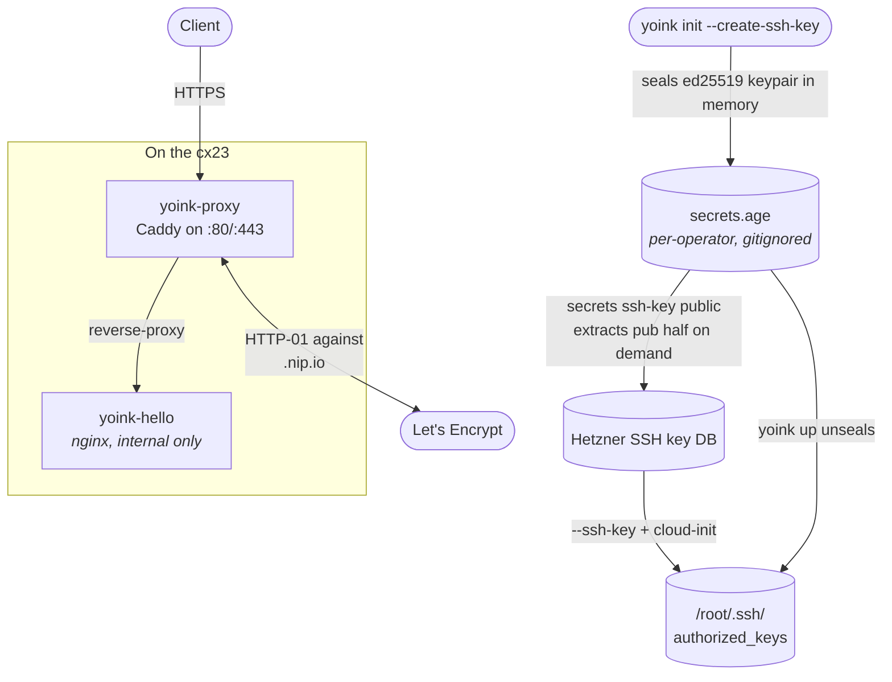

You go from an empty Hetzner project to a live HTTPS endpoint in approximately 90 seconds. You use these items:

- The cheapest x86 EU tier ([cx23](https://www.hetzner.com/cloud): €3.99/mo, 2 vCPU / 4 GB / 40 GB).
- A new AGE-sealed deploy key. No plaintext key material goes on disk.
- A real Let's Encrypt cert for `<ip>.nip.io`. You do not register a domain or create DNS records.

<Callout type="info">

**HTTPS without a domain.** `<ip>.nip.io` is wildcard DNS: `anything.1.2.3.4.nip.io` resolves to `1.2.3.4`. The [Public Suffix List](https://publicsuffix.org/) includes `nip.io` since 2018, thus each operator gets a separate Let's Encrypt rate-limit bucket.

</Callout>

## Architecture

`yoink init` seals an SSH keypair. Hetzner puts the public half on the host. Caddy on the host gets the cert and routes traffic to a placeholder service.



## Prerequisites

- A Hetzner Cloud account. If you are new to Hetzner, create an account at [accounts.hetzner.com/signUp](https://accounts.hetzner.com/signUp).
- A Hetzner project. Create one at [console.hetzner.cloud](https://console.hetzner.cloud).
- An API token with read+write scope. Generate the token in the project under **Security → API Tokens**.

Run all the commands in one terminal session. Later steps use the shell variable `IP` from an earlier step.

## Walkthrough

### Install the tools [step]

```bash
brew install hcloud
brew install oddur/yoink/yoink                               # ≥ 0.15.0
```

Then make sure that yoink is version 0.15.0 or later:

```bash
yoink --version
```

### Write the two files [step]

Create a new directory and go into it. Save the placeholder service as `services/yoink-hello.yaml`:

```yaml
# services/yoink-hello.yaml — placeholder behind the proxy
services:
  - name: yoink-hello
    image: nginx
    tag: alpine
    networks: [yoink]
    domain:
      - ${HOST_IP:-placeholder}.nip.io
    run:
      port: 80
      replicas: 1
      cmd:
        - sh
        - -c
        - "echo 'yoink!' > /usr/share/nginx/html/index.html && exec nginx -g 'daemon off;'"
      healthcheck_path: /
      healthcheck_timeout: 30s
      options:
        # Loosened for nginx-as-root; see RunOptions reference for prod-shape defaults.
        user: "0:0"
        cap_drop: []
        tmpfs:
          /usr/share/nginx/html: "size=1m,mode=0755"
          /var/cache/nginx: "size=4m,mode=0755"
          /var/run: "size=1m,mode=0755"
```

Save the cloud-init payload as `cloud-init.yaml`:

```yaml
# cloud-init.yaml — host-bootstrap, runs once on first boot
#cloud-config
package_update: true
packages: [ca-certificates, curl]
runcmd:
  - curl -fsSL https://get.docker.com | sh
  - systemctl enable --now docker
  # Pre-pull yoink's healthcheck-probe images so the first deploy doesn't race.
  - docker pull curlimages/curl:8.10.1
  - docker pull busybox:1.37
```

The directory now contains `services/yoink-hello.yaml` and `cloud-init.yaml`.

The service fragment uses [`${VAR:-default}` env-var substitution](/docs/reference/config#environment-variable-substitution). Thus the file parses before you provision a host. The format of `cloud-init.yaml` is specific to the provider, thus the file lives in your repo and not in yoink.

### Initialize the project [step]

Replace `you@example.com` with a real email address. Let's Encrypt rejects addresses on `example.com`.

```bash
yoink init --create-ssh-key DEPLOY_SSH_KEY --proxy-email you@example.com
```

The command does three things in sequence:

- It generates an [AGE identity](/docs/explanation/secrets#sealed-secrets-age) at `~/.config/yoink/keys/<age1…>.key`.
- It generates an ed25519 SSH keypair and seals the private half into a new `secrets.age` under `DEPLOY_SSH_KEY`.
- It writes `yoink.yaml`.

The directory now also contains `yoink.yaml` and `secrets.age`. The new `yoink.yaml` has these parts:

- An empty `hosts:` list. `yoink hosts add` fills it after you provision the host.
- An empty `services:` list. Your service fragment from the previous step fills it.
- `proxy.email:` for ACME.
- An `include:` list that covers `hosts/*.yaml` and `services/*.yaml`.

yoink accepts the empty lists at load time. The later steps fill both lists before `yoink up` needs them.

### Provision the cx23 [step]

When `hcloud context create` shows a prompt, paste your API token.

```bash
hcloud context create bt-scratch                     # paste API token at prompt
hcloud ssh-key create --name yoink-scratch \
  --public-key-from-file <(yoink secrets ssh-key public --name DEPLOY_SSH_KEY)
hcloud server create --name bt-scratch-01 --type cx23 \
  --image ubuntu-24.04 --location nbg1 \
  --ssh-key yoink-scratch \
  --user-data-from-file cloud-init.yaml
```

`yoink secrets ssh-key public` derives the public key in OpenSSH format from the sealed private key. The `<(…)` process substitution gives the key to hcloud as a file, thus no plaintext PEM goes to `/tmp`.

To see the new host, run `hcloud server list`. The list contains `bt-scratch-01`.

### Register the freshly-provisioned host with yoink [step]

```bash
IP=$(hcloud server ip bt-scratch-01)
yoink hosts add --address $IP --user root --ssh-key-secret DEPLOY_SSH_KEY
```

`yoink hosts add` writes a fragment under `hosts/<derived>.yaml`. Then it parses the fleet again to find address collisions. yoink never edits your `yoink.yaml` in place.

The directory now contains a `hosts/` directory with one fragment.

### Deploy [step]

```bash
HOST_IP=$IP yoink preflight --wait 90s   # waits for cloud-init to finish installing Docker
HOST_IP=$IP yoink up                      # ACME runs inline; ~5–15s for the cert
```

`yoink preflight` waits until cloud-init finishes the Docker install. Then `yoink up` unseals the SSH key and starts the bundled Caddy proxy. Caddy gets a real Let's Encrypt cert through HTTP-01 against `<ip>.nip.io`.

Both commands need `HOST_IP=$IP`. It supplies the value for `${HOST_IP:-placeholder}.nip.io` in the service fragment.

### Open the endpoint [step]

```bash
curl https://$IP.nip.io
# → yoink!
```

The response is `yoink!`.

### Look at the certificate [step]

Make sure that the cert is a real Let's Encrypt leaf:

```bash
echo | openssl s_client -connect $IP.nip.io:443 -servername $IP.nip.io 2>/dev/null \
  | openssl x509 -noout -issuer -subject -dates
# issuer=C=US, O=Let's Encrypt, CN=E8
```

The issuer line names Let's Encrypt.

## Cleanup

Remove the host and its fragment:

```bash
hcloud server delete bt-scratch-01
yoink hosts remove $(echo $IP | tr ':.' '-')         # drop the fragment
```

Hetzner bills by the hour, with the monthly price as the maximum. `hcloud server list` shows the hosts that you still pay for.

If you do not want to keep this project, also remove the Hetzner SSH key and the local files:

```bash
hcloud ssh-key delete yoink-scratch
rm secrets.age yoink.yaml
```

## See also

- [Provision a Hetzner host with HTTPS](/docs/how-to/hetzner-https-host): the same commands as one paste, how to use your own app or hostname, and fixes for failures.
- [First deploy](/docs/tutorials/first-deploy): the minimal version of this flow, without the Hetzner provisioning steps.
- [TanStack Start + postgres from scratch](/docs/tutorials/tanstack-stack): the next tutorial, which adds postgres with `yoink add`.
- [Reverse proxy](/docs/explanation/proxy): how the bundled Caddy proxy adds HTTPS to a service.
- [Sealed secrets workflow](/docs/how-to/sealed-secrets-workflow): how to manage the AGE identity and the sealed SSH key from this tutorial.
- [Configuration](/docs/reference/config): each field in the service fragment.
